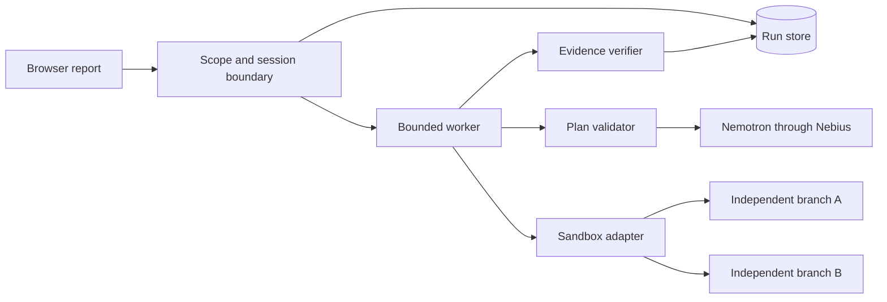
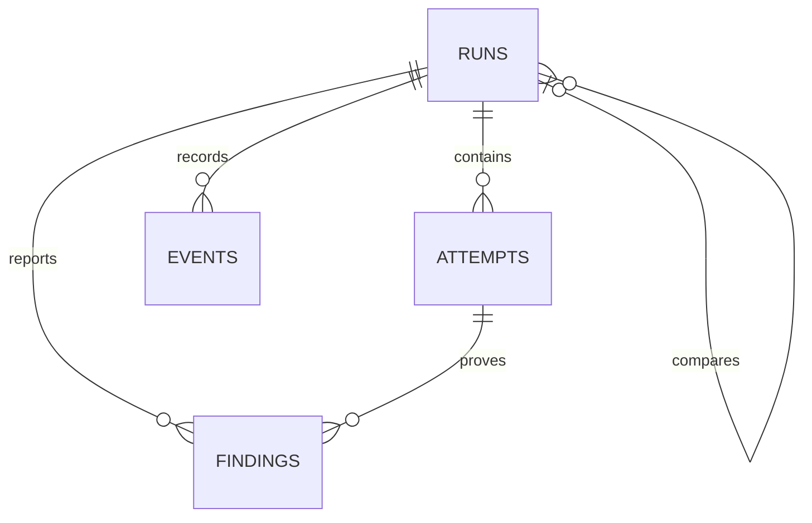
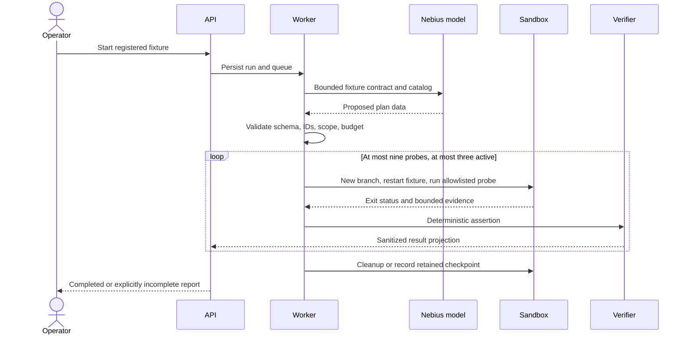

# System Design: VibeSec

**Project:** VibeSec
**Date:** 2026-09-30
**Version:** 0.1
**Owner:** Project owner
**Status:** Draft
**Last reconciled:** 2026-10-23
**PRD:** [prd-vibesec.md](prd-vibesec.md)

## 1. Architectural Vision & Principles

Proposed architecture: a Python control-plane service, a single bounded worker, a small same-origin browser interface, and remote sandbox attempts. This design is provisional until the integration spike passes.

The service owns authority; models produce data. Findings require deterministic evidence. A filesystem checkpoint is an immutable baseline to restart from, not a promise of process restoration. Keep provider adapters narrow enough to test failure and cancellation contracts.

**Current local MVP (2026-10-13):** `vibesec.web` is a standard-library HTTP server bound to `127.0.0.1`. It serves a same-origin browser UI and an in-memory plan/report store. `POST /api/plans` accepts only registered synthetic brief IDs and a local or configured Nebius planner mode; the returned plan is reviewed before `POST /api/runs` executes. The executor starts both fixture profiles on loopback and checks the owner's allowed read and the forbidden read. `GET /api/runs/{id}`, `/report.json`, and `/regression.py` expose the local result. Live Nebius planning code exists but is not account-verified; remote Sandbox execution, persistent run storage, authentication, cancellation, provider receipts, and public hosting remain the proposed architecture below. The local server must not be publicly exposed.

## 2. High-Level Architecture



| Layer | Proposed technology | Responsibility |
|-------|---------------------|----------------|
| Client | Vite, React, TypeScript, Tailwind CSS v4, selective shadcn/ui | Run status, evidence, comparisons; no provider keys |
| API | FastAPI and Pydantic, exact versions selected in spike | Input schema, operator session, scope, idempotency |
| Worker | Python 3.12 asyncio with explicit semaphore | Run transitions, budgets, provider calls, cancellation |
| Store | SQLite for one service/worker instance | Metadata, attempts, findings, events; no customer records |
| Execution | Contree client and SDK or verified low-level client | Versioned remote filesystem branches and execution receipts |
| Inference | Nebius OpenAI-compatible HTTP API | Account-available NVIDIA model, validated JSON response |

| PRD-F# | Components | Tables / endpoints |
|--------|------------|--------------------|
| PRD-F1 | Session policy, fixture registry | runs; POST /api/runs |
| PRD-F2 | Planner and policy validator | runs.plan_json; worker-internal inference |
| PRD-F3 | Worker and sandbox adapter | attempts, events; POST /api/runs/{id}/cancel |
| PRD-F4 | Verifier and report projection | findings; GET /api/runs/{id}, report export |
| PRD-F5 | Pairing validator and comparison projection | runs.parent_run_id; comparison endpoint |
| PRD-F8 | Fixture-specific regression export | GET /api/runs/{id}/regression.py in the local MVP |

## 3. Data Architecture

All timestamps are UTC ISO 8601; UI may display Asia/Manila. IDs are opaque UUID strings. Foreign keys are enabled, SQL is parameterized, and concurrent writes use short transactions. WAL mode is limited to a local persistent volume; this is a single-instance design, not a multi-tenant cluster.

**Table: `runs`**

| Column | Type | Null? | Key / constraint |
|--------|------|-------|------------------|
| id | TEXT | No | PK, UUID |
| owner_scope | TEXT | No | Opaque operator/session scope; no email |
| fixture_id, fixture_revision, profile | TEXT | No | Registered fixture and vulnerable/repaired enum |
| idempotency_key | TEXT | No | Unique with owner_scope |
| status | TEXT | No | queued, preparing, planning, running, verifying, completed, failed, cancelled, budget_exceeded |
| model_id, prompt_revision, baseline_id | TEXT | Yes | Required when corresponding stage completes |
| plan_json, limits_json | TEXT | Yes / No | Validated canonical JSON; plan absent until validated |
| parent_run_id | TEXT | Yes | FK runs.id, restricted deletion; paired repaired run |
| started_at, finished_at | TEXT | Yes | Set on transition; immutable terminal time |
| created_at, updated_at | TEXT | No | UTC; index status + updated_at for recovery |

**Table: `attempts`**

| Column | Type | Null? | Key / constraint |
|--------|------|-------|------------------|
| id, run_id | TEXT | No | PK; FK runs.id, delete cascade |
| probe_id, probe_revision | TEXT | No | Allowlisted catalog entry |
| branch_id, operation_id | TEXT | Yes | Provider receipts; persist before waiting on result |
| status | TEXT | No | queued, active, complete, error, timed_out, cancelled, skipped |
| exit_code, duration_ms | INTEGER | Yes | Nonnegative duration; exit code may be absent |
| evidence_json | TEXT | Yes | Schema-validated redacted evidence, bounded size |
| cleanup_status | TEXT | No | pending, done, failed, provider_retained |

**Table: `findings`**

| Column | Type | Null? | Key / constraint |
|--------|------|-------|------------------|
| id, run_id, attempt_id | TEXT | No | PK and FKs to run/attempt |
| assertion_id, classification | TEXT | No | Catalog assertion; confirmed or hypothesis |
| title, explanation | TEXT | No | Escaped on display; generated prose is not proof |
| evidence_json | TEXT | No | Exact deterministic assertion receipt, redacted |

**Table: `events`**

| Column | Type | Null? | Key / constraint |
|--------|------|-------|------------------|
| id | INTEGER | No | PK, monotonic per store |
| run_id, event_type, occurred_at | TEXT | No | FK run; allowlisted event; UTC |
| properties_json | TEXT | No | Bounded non-sensitive structured properties |



Retention target: metadata/evidence seven days in staging, subject to judge-access requirements for explicitly published synthetic demos. Remote checkpoint retention is provider-managed and must be documented separately. Delete expires metadata and executes the provider's supported cleanup path; it cannot promise immediate provider erasure without verified API support. No cache or vector store. Migration versions are explicit, backed up first, and compatible with the previous application release during rollback.

## 4. API Design & External Integrations

The remote-service contracts below are proposed, not implemented. The loopback MVP endpoints are described in §1. The proposed public control API requires same-origin operator session authorization plus CSRF checks. Errors use `{code, message, request_id}` with no raw upstream bodies.

| Method | Path | Purpose |
|--------|------|---------|
| GET | /api/fixtures | Return registered fixture IDs, revisions, profiles, and limits (PRD-F1) |
| POST | /api/runs | Validate scope and create an idempotent queued run (PRD-F1, PRD-F2, PRD-F3) |
| GET | /api/runs/{id} | Return authorized sanitized run projection (PRD-F4) |
| POST | /api/runs/{id}/cancel | Stop dispatch and begin cleanup (PRD-F3) |
| GET | /api/runs/{id}/report.json | Export authorized sanitized evidence (PRD-F4) |
| POST | /api/runs/{id}/compare | Create repaired replay with matching plan (PRD-F5) |
| GET | /api/health | Health only; no configuration or secrets |

`POST /api/runs`

```text
Request: {fixture_id: registry ID, profile: vulnerable|repaired}
Header: Idempotency-Key, opaque 16-128 character value
Response 202: {run_id: UUID, status: queued, limits: configured bounds}
Errors: 400 schema, 401 session, 403 scope/CSRF, 409 conflicting replay, 429 capacity
```

`GET /api/runs/{id}` and report export have no request body. Response 200 contains run ID, fixture/revision/profile, status, stage, limits, model/prompt revision, redacted attempt receipts, findings, incomplete probes, and cleanup status. Unknown or inaccessible runs return the same 404 projection to avoid enumeration. JSON export is an attachment and uses the same projection authorization.

`POST /api/runs/{id}/cancel`

```text
Request: {}
Response 202: {run_id: UUID, status: cancelling, cleanup_pending: count}
Repeated terminal requests return 200 and the existing terminal status.
```

`cancelling` above is an API stage projection; persist the cancel-request event before cleanup and persist the terminal run status afterward.

`POST /api/runs/{id}/compare`

```text
Request: {profile: repaired}
Response 202: {run_id: repaired UUID, parent_run_id: original UUID, status: queued}
Reject unvalidated plans, absent repaired lineage, active source runs, or cross-owner pairs.
```

### 4.1 Runtime sequence



Branching and client construction follow the [verified research note](research-vibesec.md). Persist explicitly when making a reusable baseline; the SDK's disposable default must be overridden. Remote fixture app and probe should run within one isolated operation using a reviewed fixed launcher, with explicit service readiness and shutdown. Provider output streams have size caps. The precise networking configuration and process orchestration are spike exit conditions, not assumed SDK features.

Provider 429 responses use bounded backoff within the run deadline. Authentication errors fail immediately. A timed-out create may have succeeded: reconcile operation receipts before retrying to avoid duplicate paid operations. Unknown state is incomplete, not success. Tavily is disabled initially; enabling it affects explanation only and requires a separate test and budget.

## 5. Security & Authorization

- The scope registry is server-owned. No input may define a host, command, environment variable, filesystem path, or credential. Fixed catalog code constructs each probe invocation.
- Model output is untrusted data. Schema and policy validators enforce the declared fixture, distinct probe IDs, maximum attempts, and supported assertions before any dispatch. Prompt instructions alone are not a security boundary.
- Provider secrets remain in the control plane; do not pass them into images, fixture environment, logs, prompts, or preserved environment metadata. A compromised fixture cannot call the model provider with control-plane authority.
- Disable sandbox egress where supported and prove loopback behavior before release. Enforce a second control-plane target registry regardless of provider policy. Do not claim network isolation until QAD evidence exists.
- Operator sessions use secure, HttpOnly, SameSite cookies, expiration, CSRF validation, and server-side run ownership. Public report tokens expose only published sanitized fixture runs; they confer no mutation authority.
- Apply HTML escaping, CSP, bounded output parsing, parameterized SQL, safe evidence filenames, TLS at deployment, and token redaction before persistence. Fixture credentials are synthetic and never reused as operator credentials.
- Probe execution limit proposal: nine attempts/run, three active, 60 seconds/attempt, 64 KiB captured output/attempt, 30 fixture requests/attempt, five-minute total deadline. These are application limits; provider quotas may be lower.

## 6. Infrastructure, CI/CD & Deployment

Repository documentation validation uses `scripts/check_project_docs.py`; an optionally supplied FMD v3.0.1 engine provides the separate strict check. The frontend has a dependency lock and production build, while Python packaging, hosting, TLS, operator identity provisioning, persistent storage, and CI do not exist yet. Planned deployment is one service and worker with a persistent volume and read-only fixture images; the host is chosen after the spike. Do not deploy a public command-execution API.

For synthetic runs: back up metadata before migration; proposed RPO 24 hours and RTO one hour. No restore has been tested. The service can recreate fixtures from pinned revisions. Provider secrets live in deployment configuration, not the backup. Follow PRD §9 for rollback.

## 7. Non-Functional Requirements

| Requirement | Proposed target | Evidence needed |
|-------------|-----------------|-----------------|
| Control API p95 | Under 500 ms excluding remote execution | Staging trace sample |
| First complete report | Under five minutes for nine probes | Cold-start benchmark |
| Concurrency | One operator run, three active attempts | Capacity and cancellation test |
| Scope breaches / fabricated confirmed findings | Zero in release evaluation corpus | QAD abuse and verifier tests |
| Metadata retention | Seven days in staging; published synthetic demo through judging | Cleanup job and accessibility test |
| Cost | Configured token/resource limits; currency ceiling calibrated before release | Actual provider usage and pricing |

## 8. AI Architecture

One planner maps a registered synthetic brief to an allowlisted security promise and that promise's exact probe pair. No model receives raw unrestricted shell access. Use a versioned prompt, immutable fixture contract, and promise/probe catalog; separate untrusted fixture text from instructions. JSON output support varies by model, so local validation is mandatory even if the provider supplies a structured-output mode. The first live integration selects and records the exact available model ID and version where the provider exposes one.

### 8.1 Threat controls

| Risk | Control | QAD eval |
|------|---------|----------|
| Prompt injection, including fixture text | Label input, prohibit authority from content, validate all plan fields | AI-04 |
| Improper output handling | Model output never executed; evidence rendered escaped | AI-03, AB-02 |
| Sensitive information disclosure | No provider keys in prompts or sandbox; redaction before persistence | AI-06 |
| Excessive agency | Fixed catalog, immutable target registry, hard budget and dispatch caps | AI-05 |
| Jailbreak | Unsupported plan rejected; no silent retry after one repair attempt | AI-07 |
| Hallucinated finding | Only deterministic verifier creates confirmed classification | AI-02 |

The applicable boundary is informed by [OWASP prompt-injection guidance](https://genai.owasp.org/llmrisk/llm01-prompt-injection/), checked 2026-09-30. Data sent to Nebius is limited to the synthetic contract/catalog. Account-specific retention, training use, and region are unresolved; customer data is excluded until CLR is reconciled.

### 8.2 AI craft

Prompt: instructions, catalog, and untrusted contract occupy separate labeled sections. Context: minimum synthetic metadata only. Harness: deterministic policy before dispatch. Loop: one plan call and at most one repair call, then stop. Budget: PRD §7 caps plus measured provider usage. Evaluation: QAD AI-01 through AI-07 before model or prompt changes.
